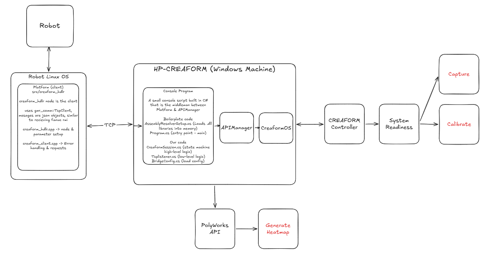

I began development working towards a bridge that allows more automated process development and robustness testing of the recipes we develop. There is currently no standard communication protocol between Linux & Window machines but we can utilize barebones TCP + .json \n to be the messenger between the client (platform) & the service (C# project). 

Here is the overall architecture for Linux-Windows Bridge discussed below is the workflow and context for each of these modules

Platform will be responsible for any client side commands that are necessary for the adaptive sanding to proceed. Any long-term actions required for software (capture, calibration, heatmap generation) will be managed at a high-level from platform. Most of the Creaform logic & state handling will exist on the Windows side since the API Manager can be queried efficiently. The bridge can effectively own the truth of whatever is happening on Creaform side and can pass all necessary information through the bridge back to snx. 

I currently built the windows bridge within platform/scripts/creaform-bridge, which should be moved to its own repository 100%, will take care of that next

Step-by-step detailed flow of operation

Platform

Platform (client): src/creaform_hdlr. The creaform_hdlr node is the client of the Windows bridge. It uses gmr_comms::TcpClient, the same TCP client fanuc_motion uses for the Fanuc RMI, and exchanges newline-delimited JSON objects with the bridge. creaform_hdlr.cpp holds the node, parameters and the /creaform_hdlr/connect service. creaform_client.cpp holds the connection handling, request and reply matching by id, timeouts and error codes.

launch node & make service call to connect to creaform

ros2 launch creaform_hdlr creaform_hdlr.launch.py
ros2 service call /creaform_hdlr/connect std_srvs/srv/Trigger

CreaformAPI

The source code + .dll required to build this application & run all necessary Creaform operations were provided during our 10/13 API training.

Application Tab

Scanning Tab

Console Script

Console script is a small C# console program that serves as the bridge between platform & APIManager. It is structured similarly to how CreaformAPI was made. The only boilerplate code that exists between the two is AssemblyResolverSetup.cs, which currently finds two .dll (CreaformAPi.dll & CreaformAutomationAPi.dll) libraries at runtime.

Our coding files

1. Program.cs - entry point for the code (main), registers the resolver to find the necessary packages, loads the bridge config, & begins the console tcp listener
2. CreaformSession.cs - the service layer over the CreaformAPI & all eventual modules, it is the only file that communicates with APIManager
   1. It also provides locks on both TCP & Creaform event threads during operation, preventing accidental concurrent service calls that crash the API (happened during training lol)
   2. Catches any API exceptions returned from APIManager and packages to return back to the Linux via Result
      1. Result(Ok, Code, Message, Data)
         1. Ok: success/fail
         2. Code: event that platform can act on ("connected")
         3. Message: human-readable error text, "calibration too old"
         4. Data: kwargs basically
   3. Manages event relays
3. Tcplistenerserver - the lower level json manager, handles tcp connection:
   1. reads one json per newline
   2. listener gets result from creaformsession and serializes that to be sent back over tcp
   3. writes replies
4. BridgeConfig.cs - similar to the platform equivalent, just loads bridge config settings

API Manager

APIManager serves as our connection to CreaformOS, this is the software that the user can see & operate manually. It manages event/actions such as Connect, IsConnected, IsInstalled & Disconnected, when CreaformOS gets these calls, it drives the hardware.

 It also owns the property .Application, which allows us to access the various modules included in CreaformOS such as 

1. Scan & ScanAutomation (start scan, end scan)
2. Tracker & TrackerAutomation(import/load tracker, add new tracker)
3. Other modules such as Probe, Photogrammetry, etc.

Parameters

1. Creaform Windows IP: 192.168.11.100
2. Bridge Port: 5555
3. Request_timeout (s): 30